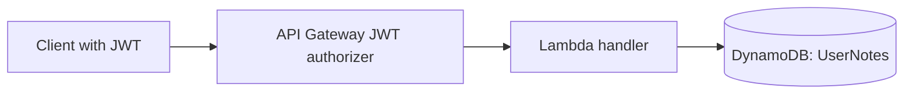

# Cloud Notes API

**AWS Lambda handler samples for saving and retrieving one note per authenticated user.**

These JavaScript handlers connect API Gateway HTTP API events to a DynamoDB table. The user ID comes from the JWT authorizer's `sub` claim, so each user's note is stored under their authenticated identity.

These handler samples were originally published on the [JSON branch of my project collection](https://github.com/Stormshaper455/My-projects-/tree/JSON). This dedicated repository presents that same source with descriptive filenames, configuration notes, and a request-flow diagram.

## Request flow



| Handler | Operation | Result |
| --- | --- | --- |
| [get-notes.mjs](get-notes.mjs) | `GetCommand` using the authenticated `UserId` | Returns the saved note, or an empty string when no item exists |
| [save-notes.mjs](save-notes.mjs) | `UpdateCommand` setting the `note` attribute | Creates or replaces the user's current note and returns a confirmation |

## Expected AWS configuration

These are backend source samples, not a complete deployment package. To run them in AWS, configure:

1. A DynamoDB table named `UserNotes` with a string partition key named `UserId`.
2. Lambda functions using a supported Node.js runtime and ES modules.
3. AWS SDK for JavaScript v3 dependencies: `@aws-sdk/client-dynamodb` and `@aws-sdk/lib-dynamodb`.
4. An execution role with the necessary `dynamodb:GetItem` or `dynamodb:UpdateItem` permission for this table.
5. An API Gateway HTTP API with a JWT authorizer that supplies `event.requestContext.authorizer.jwt.claims.sub`.

Use `get-notes.handler` and `save-notes.handler` as the handler names when the corresponding `.mjs` file is placed at the root of each function's deployment package. Supply the SDK dependencies in that package or a Lambda layer.

No AWS credentials belong in this repository. The handlers obtain AWS access through their execution environment.

## Local setup and syntax checks

```bash
git clone https://github.com/Stormshaper455/aws-notes-api.git
cd aws-notes-api
npm install
npm run check
```

The check validates JavaScript syntax. It does not call AWS or exercise DynamoDB. Running the handlers requires the AWS configuration described above.

## Example payloads

Save request body:

```json
{"note":"Review database project before the interview."}
```

Save response body:

```json
{"message":"Note saved"}
```

Read response body:

```json
{"note":"Review database project before the interview."}
```

These JSON examples illustrate the handler contract; they are not responses captured from a live deployment.

## Technical decisions and limitations

- **One item per user:** the `UserId` partition key keeps the data model simple. Saving replaces the current note; it does not keep note history.
- **Identity from the authorizer:** the handlers use the verified request context instead of accepting a user ID in the request body. The authorizer must be configured correctly before invoking the handlers.
- **Document client:** DynamoDB's document client accepts plain JavaScript values.
- **Current gaps:** malformed JSON, missing claims, invalid note values, and database failures are not yet handled explicitly. CORS headers are permissive and should be narrowed to the intended frontend origin before a production deployment.

The repository does not include a frontend, infrastructure templates, a public endpoint, or live AWS integration tests. No cloud resources are created by cloning or reading this project.

---

Built by [Joshua Wilson](https://github.com/Stormshaper455) · [Python + SQL Staff Manager](https://github.com/Stormshaper455/python-sql-staff-manager)
